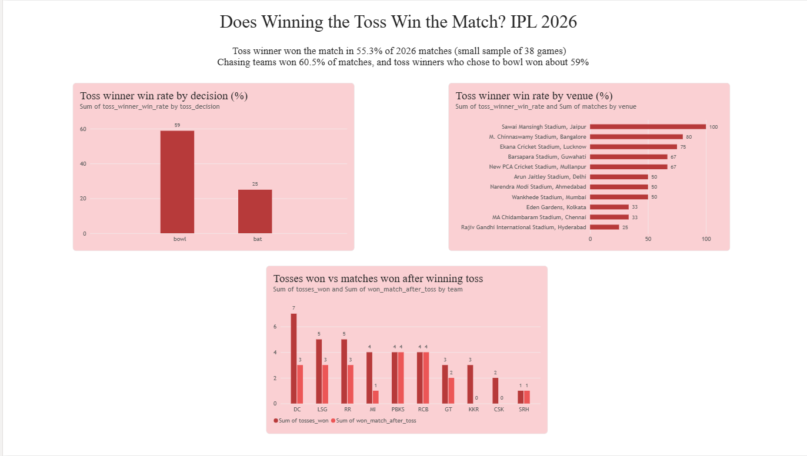

# IPL 2026 Toss Impact Analysis

Does winning the toss help a team win the match? This project analyzes IPL 2026 match data with Python and presents the results in a Power BI dashboard.

## Dashboard

## Key Findings

- The toss winner went on to win the match in **55.3%** of matches (21 of 38 matches with a result).
- Teams batting first won **39.5%** of matches, while chasing teams won **60.5%**.
- Toss winners who chose to **bowl first** won about **59%** of their matches, compared with **25%** for those who chose to bat.
- Venue and team results are based on very few matches each (1 to 3 per venue), so they are exploratory and not strong conclusions.

**Note on sample size:** The data covers a single season (38 matches with a result), so these results show a pattern in 2026 and should not be treated as a general rule.

## Tools Used

- Python (pandas) for data cleaning and analysis
- Power BI for the dashboard

## Project Files

- `ipl_2026_analysis.py`: cleans the data and calculates toss, venue and team statistics
- `matches.csv`: IPL 2026 match data (source: Kaggle)
- `ipl_toss_dashboard.pbix`: Power BI dashboard
- `dashboard.png`: screenshot of the dashboard

## How to Run

1. Install pandas: `python -m pip install pandas`
2. Place `matches.csv` in the same folder as the script.
3. Run: `python ipl_2026_analysis.py matches.csv`
4. The script prints the results and saves CSV files that can be loaded into Power BI.

## What I Did

1. Cleaned the data by removing duplicates and dropping matches with no result.
2. Compared how often the toss winner also won the match, overall and by toss decision.
3. Worked out which team batted first in each match to compare batting first and chasing.
4. Summarized results by venue and by team and built a Power BI dashboard.
